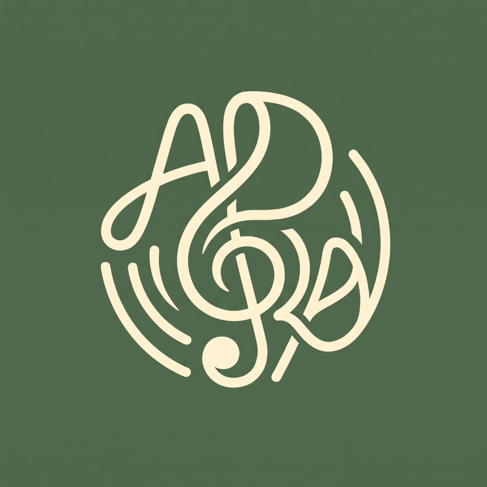

<div align="center">



# Adora
### *Acoustic Sanctuary, Reimagined.*

A self-hosted, zero-cost, high-fidelity music streaming ecosystem, personal cloud, and social listening studio.  
Built for audiophiles, curated language collections, and close circles of friends.

[](https://www.gnu.org/licenses/gpl-3.0)
[](https://tauri.app/)
[](https://react.dev/)
[](https://tailwindcss.com/)
[](https://www.oracle.com/cloud/free/)

</div>

---

## ✦ The Anti-Corporate Music Sanctuary

Commercial streaming platforms monetize listening through algorithmic addiction, intrusive ads, lossy audio compression, and endless subscription price hikes. **Adora is designed around comfort, visual quietude, absolute privacy, and true ownership.**

* **$0.00 Forever:** Runs permanently on the Oracle Cloud Always Free Tier with zero recurring subscription fees.
* **Lossless Audio Streaming:** Streams high-fidelity audio (FLAC up to 24-bit/96kHz or transparent 256–320kbps Opus/MP3) with zero artificial quality paywalls.
* **Just-in-Time (JIT) Dynamic Ingestion:** Starts with 0 MB of music and grows organically. Tracks are discovered, streamed immediately, tagged, and cached in the background only when someone in your circle searches for them.
* **Self-Healing Storage:** Automated LRU cache eviction engine that automatically prunes forgotten tracks while strictly protecting songs saved in any user's playlists or favorites.
* **Adora Blend:** Real-time synchronized room listening with friends over WebSockets with clock drift compensation.
* **Adora Connect:** Cross-device remote control and playback handoff for the same account across desktop and mobile.
* **Tri-Platform Delivery:** Single codebase in Tauri 2.0 + React delivering Native Desktop (Linux, Windows, macOS), Native Android (`.apk`), and Direct Browser Web App.

---

## 🎨 Visual Identity & Palette

Inspired by vintage acoustic gear (Bang & Olufsen, Braun, Marshall) and organic botanical tones:

| Color Tone | Hex Code | Purpose |
| :--- | :--- | :--- |
| **Botanical Olive** | `#4F694C` | Brand Anchor & Primary Controls |
| **Luminous Sage** | `#7C9372` | Secondary Accents & Dark Highlights |
| **Warm Buttermilk Cream** | `#FFFFE7` | Analog Lettering & Glyphs |
| **Linen Canvas** | `#F8F5EE` | Light Mode Background |
| **Midnight Moss** | `#121612` | Dark Mode Velvet Noir |

---

## 🏛️ System Architecture

```
┌─────────────────────────────────────────────────────────────────────────────┐
│                       ORACLE CLOUD (Ubuntu ARM64)                           │
│                                                                             │
│  [ Keep-Alive Cron ] ── (Spikes CPU 15-20% for 5 min every 4h)             │
│                                                                             │
│  ┌───────────────────────┐         ┌─────────────────────────────────────┐  │
│  │   Navidrome Engine    │         │      Adora Companion Hub            │  │
│  │   (Subsonic API)      │         │      (Node.js / Express / ws)       │  │
│  ├───────────────────────┤         ├─────────────────────────────────────┤  │
│  │ • Multi-user auth     │         │ • Real-time WebSockets (Blend/Jam)  │  │
│  │ • Public/Private lists│◄───────►│ • On-Demand Song Ingestion Engine   │  │
│  │ • Audio streaming     │         │ • Admin Analytics & Storage Metrics │  │
│  │ • Favorites & History │         │ • 2FA OTP & 3-Tier Recovery         │  │
│  └───────────┬───────────┘         └──────────────────┬──────────────────┘  │
│              │                                        │                     │
│              └───────────────────┬────────────────────┘                     │
│                                  ▼                                          │
│                    [ 200 GB Block Storage /music ]                          │
└──────────────────────────────────┬──────────────────────────────────────────┘
                                   │ HTTPS / WSS (via Cloudflare Tunnel)
                                   ▼
          ┌──────────────────────────────────────────────────┐
          │      Adora Clients (Tri-Platform Delivery)       │
          │                                                  │
          │  • Desktop Native (Windows, Linux, macOS)        │
          │  • Mobile Native (Android APK)                   │
          │  • Direct Browser Web App                        │
          └──────────────────────────────────────────────────┘
```

---

## 🚀 Quick Start Guide

### 1. Running the Web Application Locally
```bash
# Clone the repository
git clone https://github.com/sreeshivsanth/Adora.git
cd Adora/app

# Install dependencies and start Vite dev server
npm install
npm run dev
```
Open **`http://localhost:3000`** in your browser to experience the acoustic sanctuary!

### 2. Deploying the Cloud Server Stack
On your Oracle Cloud Always Free Ubuntu ARM64 instance:
```bash
git clone https://github.com/sreeshivsanth/Adora.git
cd Adora/server/scripts
sudo ./setup-oracle.sh

cd ../
docker compose up -d
```

---

## 📋 Comprehensive Master Plan
For the full master specification, security audit, database schema, and completion checklist, see:
* **[plan.md](./plan.md)**

---

<div align="center">
Built with devotion for authentic listening.
</div>
