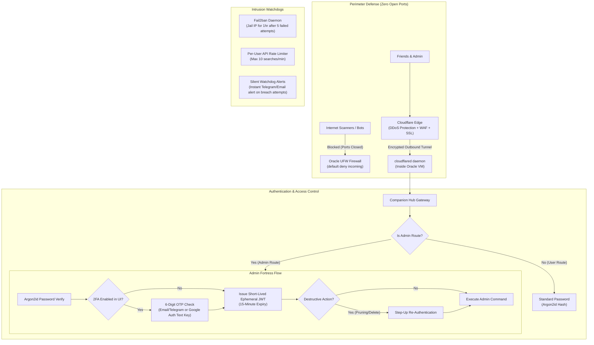
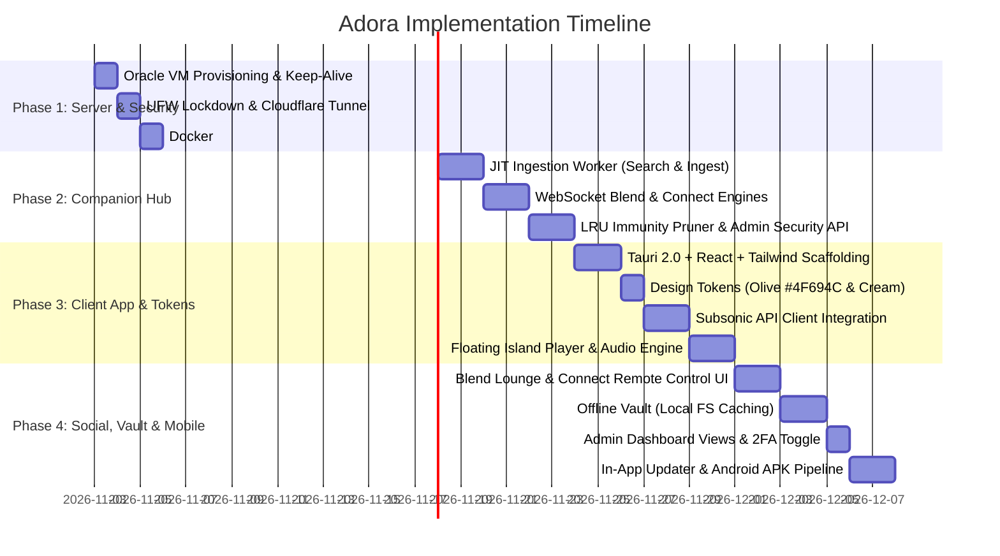

# Adora — Comprehensive Product Blueprint & Master Architecture Specification

> **"Acoustic Sanctuary, Reimagined."**  
> Adora is a self-hosted, zero-cost, high-fidelity music streaming ecosystem, personal cloud, and social listening studio. Built for audiophiles, curated language collections, and close circles of friends, Adora combines the tactile warmth of an analog listening room with enterprise-grade Zero-Trust cloud security.

---

## 1. Executive Summary & Brand Identity

### 1.1 Philosophy: The Anti-Corporate Music Sanctuary
Commercial streaming platforms prioritize algorithmic monetization, intrusive advertisements, lossy compression, and perpetual subscription fees. Adora is designed around **comfort, visual quietude, absolute privacy, and true user ownership**:
* **Zero Subscriptions ($0.00 Forever):** Runs permanently on the Oracle Cloud Always Free Tier with zero recurring costs.
* **Lossless Audio Streaming:** Streams high-fidelity audio (FLAC up to 24-bit/96kHz or transparent 256–320kbps Opus/MP3) with no artificial quality paywalls.
* **Just-in-Time (JIT) Dynamic Ingestion:** Starts with 0 MB of music and grows organically. Tracks are discovered, streamed immediately, tagged, and cached in the background only when someone in your circle searches for them.
* **Self-Healing Storage:** An automated LRU (Least Recently Used) cache eviction engine that automatically prunes forgotten tracks while strictly protecting songs saved in any user's playlists or favorites.
* **Adora Blend (Social Listening):** Real-time synchronized room listening with friends over WebSockets with clock drift compensation.
* **Adora Connect (Device Linking):** Seamless cross-device remote control and playback handoff for the same account across desktop and mobile.
* **Tri-Platform Delivery:** A single codebase in **Tauri 2.0 + React + Tailwind CSS** delivering:
  1. **Native Desktop Apps:** Windows (`.exe`), Linux (`.AppImage` / `.deb`), and macOS.
  2. **Native Mobile App:** Android (`.apk` distributed freely via GitHub Releases with in-app auto-updating).
  3. **Direct Browser Web App:** Accessible instantly from any browser with zero installation.

---

### 1.2 Brand Identity & Design System

#### The Emblem / Logo
* **Visual Identity:** A circular calligraphic monogram weaving **"ADORA"** into a musical **Treble Clef** and resonant soundwave ripples.
* **Asset Location:** `logo.jpg` (stored in the project root directory).
* **Color Heritage Extracted from Asset:**
  * **Botanical Olive Background:** `#4F694C` (Organic Forest Sage)
  * **Glyphs & Lettering:** `#FFFFE7` (Warm Buttermilk Cream)

#### Semantic Design Tokens & Theme Palettes

| Token Name | Light Mode ("Linen & Botanical") | Dark Mode ("Midnight Moss") | UI Function |
| :--- | :--- | :--- | :--- |
| **`--canvas-bg`** | `#F8F5EE` (Warm Linen Cream) | `#121612` (Velvet Forest Noir) | Primary application background |
| **`--surface-card`** | `#EFECE3` (Soft Oat Canvas) | `#1B221A` (Moss Slate) | Card backgrounds, drawers, modals |
| **`--surface-hover`** | `#E5E0D4` (Pressed Paper) | `#232C22` (Elevated Forest) | Hover states, active playlist rows |
| **`--accent-primary`**| `#4F694C` (Adora Botanical Olive) | `#7C9372` (Luminous Sage) | Play buttons, active indicators |
| **`--accent-secondary`**| `#63725E` (Warm Khaki Olive) | `#FFFFE7` (Buttermilk Cream) | Secondary badges, progress fill |
| **`--text-primary`** | `#22241F` (Espresso Charcoal) | `#FFFFE7` (Pearl Buttermilk) | Titles, headings, track names |
| **`--text-muted`** | `#6B7065` (Muted Olive Leaf) | `#9DA496` (Oat Sage) | Artists, timestamps, durations |
| **`--border-subtle`** | `rgba(79, 105, 76, 0.12)` | `rgba(255, 255, 231, 0.08)`| Hairline borders, dividers |

#### Visual Ergonomics & Micro-Interactions
* **Curvature:** Generous `16px` to `24px` radii (`rounded-2xl` / `rounded-3xl`) for physical softness.
* **Acoustic Ramping:** Gentle 200ms volume ramping on play/pause/seek (no abrupt digital clicks or pops).
* **Ambient Lighting:** Soft, blurred ambient glow cast behind album art reflecting dominant cover colors.
* **Anti-Glare Lighting:** Carefully calibrated contrast ratios preventing eye fatigue in low-light environments.

---

## 2. UI/UX Layout & Ergonomics

Instead of copying Spotify's dense spreadsheet layout, Adora adopts a **Studio & Floating Island** design.

```
┌─────────────────────────────────────────────────────────────────────────────┐
│  [Logo: Adora]  [Tamil] [Hindi] [English] [Korean]   [🔍 Search...] [Admin] [☀️/🌙] │ (Top Ambient Bar)
├────────┬────────────────────────────────────────────────────────────────────┤
│        │                                                                    │
│  [✦]   │  HERO / NOW SPINNING:                                              │
│ Studio │  ┌──────────────────────────────────────────────────────────────┐  │
│        │  │  [ Rotating Vinyl / Artwork ]   "Song Title"                 │  │
│  [♫]   │  │                                 Artist • Album (2024)        │  │
│ Vault  │  │  [● Blend Session: 3 Friends Syncing]   [⬇ Stored in Vault] │  │
│        │  └──────────────────────────────────────────────────────────────┘  │
│  [👥]   │                                                                    │
│ Blend  │  CURATED SHELVES:                                                  │
│        │  ┌───────────────┐ ┌───────────────┐ ┌───────────────┐             │
│  [☁]   │  │ Public Shelf  │ │ My Favorites  │ │ Offline Vault │             │
│ Offline│  │ (Community)   │ │ (Private)     │ │ (Device-Only) │             │
│        │  └───────────────┘ └───────────────┘ └───────────────┘             │
├────────┴────────────────────────────────────────────────────────────────────┤
│                    ┌──────────────────────────────────┐                     │
│                    │  ⏮   ▶/⏸   ⏭   ━━━●━━━━━   🔊  │                     │ (Floating "Acoustic Island" Dock)
│                    └──────────────────────────────────┘                     │
└─────────────────────────────────────────────────────────────────────────────┘
```

### 2.1 The Key Structural Components
1. **Zen Navigation Rail (Left):** Collapsible 64px vertical rail containing:
   * **Brand Anchor:** Custom Adora circular monogram logo (`logo.jpg`).
   * **Studio:** Now Playing, curated shelves, and language filter collections.
   * **Vault:** User's personal library (Playlists, Liked Songs, Offline Downloads).
   * **Blend Lounge:** Real-time synchronized listening campfire.
   * **Admin Studio:** Dynamically rendered only when authenticated as an Admin.
2. **Top Ambient Header:**
   * **Language Filter Pills:** Instant category pills (`All`, `Tamil`, `Hindi`, `English`, `Korean`, etc.) for zero-latency collection browsing.
   * **Global Dual Search:** Searches the local server catalog first; seamlessly offers "Search Online Catalog" on cache miss.
   * **Theme Switcher:** Fluid toggle between Linen Light and Midnight Moss Dark modes.
3. **Floating "Acoustic Island" (Bottom Player):**
   * Pill-shaped glassmorphic player floating 16px above the canvas.
   * Houses album art, track details, tactile transport controls, fluid progress scrubber, volume dial, device selector, and offline download toggle.
4. **Living Room Mode (Zen Focus):**
   * One-tap distraction-free view featuring a gently rotating vinyl disc, warm ambient lighting reflecting cover colors, and synchronized, slow-scrolling lyrics.

---

## 3. Zero-Cost Infrastructure Architecture ($0.00 Forever)

### 3.1 Oracle Cloud Always Free Tier Specifications
Adora runs permanently within Oracle Cloud Infrastructure (OCI) Always Free tier limits:
* **Compute Architecture:** Ampere A1 ARM64 (`aarch64`).
* **Processor Allocation:** Up to 4 OCPUs (allocated as 2 cores active, 2 cores reserve).
* **Memory Allocation:** Up to 24 GB RAM (allocated as 8–12 GB active).
* **Storage Allocation:** **200 GB persistent block storage** included free.
* **Egress Bandwidth:** 10 TB/month free outbound traffic (allows ~300,000+ song streams/month).
* **Public IPv4:** 1 free permanent static IP address.

#### Storage Capacity Math (Curated Collection)
| Audio Format | Average Track Size | 10 GB | 50 GB | 200 GB (Oracle Free Tier) |
| :--- | :--- | :--- | :--- | :--- |
| **FLAC (Lossless 16/24-bit)** | ~25–30 MB | ~350 songs | ~1,800 songs | **~6,500 to 8,000 songs** |
| **MP3 / Opus (320kbps High)**| ~7–8 MB | ~1,250 songs | ~6,250 songs | **~25,000 songs** |

Limiting your library to curated favorite artists across 2–4 languages fits comfortably within the 200 GB disk indefinitely.

---

### 3.2 Anti-Reclamation: Keep-Alive Cron Engine
To ensure Oracle never flags the instance as "idle" (without upgrading to Pay-As-You-Go):
* **The Policy:** Oracle marks free tier VMs as idle if CPU utilization stays below 15–20% for 7 consecutive days. Because a music server idles at <1% CPU when nobody is listening, a background watchdog is required.
* **The Solution:** A lightweight systemd service / cron job running a controlled CPU calculation (using `lookbusy` or a Python math loop) for 5 minutes every 4 hours.
* **The Result:** The 7-day rolling CPU utilization average remains safely at ~18–22%, guaranteeing the instance is never deleted or suspended.

---

### 3.3 Zero-Cost Networking & Tunneling
* **Network Gateway:** Cloudflare Tunnel (`cloudflared`) daemon running inside the Oracle VM.
* **Perimeter Defense:** All inbound firewall ports (80, 443, 22, 4533) are locked down (`ufw default deny incoming`).
* **Domain Name Options:**
  * **Option A ($0.00):** Free DuckDNS dynamic subdomain (e.g. `adora-music.duckdns.org`) routed via Cloudflare Tunnel.
  * **Option B ($0.00):** Cloudflare free quick tunnel (`*.trycloudflare.com`).
  * **Option C (Optional ~$1–$2/year):** Custom branded domain (e.g. `music.adora.xyz`).

---

## 4. Comprehensive Zero-Trust Security Architecture

Security is central to Adora: while friends enjoy seamless music streaming, **the Admin controls, server perimeter, and database are fortified against unauthorized access or tampering**.



### 4.1 Admin Protection & Ephemeral Tokens
1. **Argon2id Hashing:** Industry-standard memory-hard password hashing for all user and admin accounts.
2. **Flexible Two-Factor Authentication (OTP):**
   * **No Camera QR Scanning Required:** Uses a simple 6-digit OTP code sent via Email/Telegram, or a short copy-paste setup key in Google Authenticator.
   * **Configurable Admin Toggle:** Located in `Admin Settings -> Security`:
     ```
     [ Enable / Disable 2-Factor Authentication (OTP) ] (ON/OFF)
     ```
     Admin can turn 2FA off for quick friction-free access, or toggle it on for maximum lockdown.
3. **Ephemeral 15-Minute Admin JWTs:**
   * Admin access tokens expire strictly after **15 minutes**.
   * Supported by **Rolling Refresh Tokens** stored in secure deep storage: while you are active, the app automatically refreshes your token in the background with zero interruptions.
   * If an attacker intercepts your token, it dies within 15 minutes.
4. **Step-Up Authentication:** Critical destructive actions (e.g., deleting users, wiping storage, altering server parameters) require step-up re-authentication.
5. **Zero-Trust Server Validation:** Hiding buttons in the client UI is purely cosmetic; all administrative endpoints (`/api/admin/*`) mathematically verify the Admin JWT signature on the Oracle server. Non-admin tokens receive `403 Forbidden` and trigger an alert.
6. **Universal Admin Login:** Admin status follows your user account (`isAdmin: true`). Logging in on **any device** (phone, desktop, browser) automatically unlocks the Admin Studio.

---

### 4.2 User Security & Privacy Protections
Security is not reserved only for the Admin; every friend using Adora is protected with modern safeguards:
1. **Isolated Cryptographic Scopes:** User tokens are strictly scoped (`role: "user"`). A user can never read, modify, or query another user's private playlists, starred favorites, or listening history.
2. **Encrypted Device Vaults:** On Android, tokens and cached keys are stored in the hardware-backed **Android Keystore** / `EncryptedSharedPreferences`. On desktop, they are secured via native OS credential vaults.
3. **Account Brute-Force Shields:** If a specific user account experiences 5 failed login attempts in a row, that account is locked for 15 minutes to defeat dictionary attacks.
4. **Device Session Management:** Inside User Settings, any user can see where they are logged in (e.g. *"Chrome on Windows"*, *"Adora on Galaxy S24"*) and tap **"Log Out of Other Devices"** at any time.

---

### 4.3 Universal "Forgot Password" Engine (3-Tier Recovery)
To guarantee nobody is ever permanently locked out of their music:

```
[ User / Admin clicks "Forgot Password?" ]
                     │
                     ▼
       ┌─────────────────────────────┐
       │ Enter Registered Email      │
       └──────────────┬──────────────┘
                      │
                      ▼
     Server generates single-use, cryptographically 
     random token (expires in 15 minutes)
                      │
                      ▼
        Sends Password Reset Link / OTP
                      │
                      ▼
       User sets new password ──► Server invalidates all old sessions
```

1. **Tier 1: Self-Service Email Recovery (Automated for Users & Admin):**
   * The user clicks *"Forgot Password"*, enters their registered email, and receives a secure 6-digit reset code or one-click magic link.
   * Clicking the link opens Adora to enter a new password. The reset token is single-use and immediately invalidated.
2. **Tier 2: Admin-Assisted Friend Recovery:**
   * If a friend forgets their password and doesn't have access to their email:
   * You can open your **Admin Studio**, tap on the friend's name -> click **"Reset Password"** or **"Generate One-Time Login Code"**, and send it to them directly over WhatsApp or Discord.
3. **Tier 3: The "Admin Disaster Recovery" CLI (Zero-Lockout Guarantee):**
   * If you (the Admin) ever forget your password AND lose access to your email:
   * Because you have SSH access to your Oracle Cloud VM, we include a secure server CLI utility:
     ```bash
     docker exec -it adora-hub adora-admin reset-password --admin "NewStrongPassword123!"
     ```
   * Running this single command instantly updates the database. **You can never be locked out of your own server.**

---

### 4.4 Network & Server Perimeter Lockdown
1. **Zero Open Inbound Ports:**
   * Oracle Cloud firewall configured with `ufw default deny incoming`.
   * Ports 80, 443, 22, and 4533 are **completely closed** to direct public internet traffic.
   * All ingress routes exclusively through an encrypted outbound **Cloudflare Tunnel (`cloudflared`)**.
2. **Hardened SSH Access:**
   * Passwords disabled over SSH (`PasswordAuthentication no`).
   * Access restricted exclusively to **Ed25519 private cryptographic keys**.
3. **Automated IP Jailing (Fail2ban):**
   * 5 consecutive failed login attempts trigger an immediate 60-minute IP block.
4. **Silent Incident Watchdog:**
   * Any unauthorized attempt to probe admin routes or anomalous traffic bursts immediately triggers an automated notification to the owner's private Telegram bot or email.

---

## 5. Core Functional Modules

### Module 1: The Client Experience (Tauri 2.0 + React + Tailwind)
* **Framework:** React 19 + TypeScript + Vite.
* **Desktop Wrapper:** Tauri 2.0 (Rust native shell).
* **Styling:** Vanilla CSS design system via Tailwind CSS with custom CSS variables.
* **Icons:** Lucide React icons styled with subtle stroke animations.
* **State Management:** Zustand for lightweight, reactive audio state and session caches.

---

### Module 2: Multi-User Core & Privacy (Navidrome / Subsonic)
Adora uses the battle-tested **Subsonic REST API** implemented by Navidrome as its primary music and user layer.
* **Isolated User Accounts:** Each friend has an independent profile with private listening history, play counts, and starred favorites.
* **Public vs. Private Playlists:** Users can flag any playlist as:
  * 🔒 **Private:** Strictly visible only to the creator.
  * 🌐 **Public:** Displayed on the Community Shelf for all friends on the server.
* **Scrobbling:** Built-in support for personal history tracking compatible with Last.fm and ListenBrainz.

---

### Module 3: Just-in-Time (JIT) Dynamic Ingestion Engine
Adora starts with an empty music folder. Disk space is consumed only when someone actually wants to listen to a song.

```
[ User Searches "Song Name - Artist" ]
                   │
                   ▼
       Is track in Navidrome DB?
        ├──► [YES] ──► Return local high-fidelity stream immediately (<50ms)
        │
        └──► [NO]  ──► Query Public Internet Metadata (Spotify/Deezer API)
                         │
                         ▼
             User taps "Play" or "Add"
                         │
                         ├──► 1. Client starts streaming preview URL (Instant start < 1s)
                         │
                         └──► 2. Companion Hub background worker:
                                 • Downloads highest-bitrate stream
                                 • Injects clean ID3 tags (Title, Artist, Album, Year)
                                 • Embeds high-resolution cover art
                                 • Saves to `/music/Language/Artist/Album/Track.ext`
                                 • Calls Navidrome `/rest/startScan`
                                 • Subsequent plays stream the local high-fidelity file
```

---

### Module 4: "Adora Blend" (Synchronized Group Listening)
Allows friends in different locations to listen to music simultaneously in real time.
* **Invite Flow:** Host generates a session code (e.g. `BLND-8492`) or a shareable link (`adora://blend/join?code=BLND-8492`).
* **WebSocket Drift Compensation:** Clients synchronize audio clock with the server. If drift > 300ms, it performs a micro-seek; if drift < 300ms, it temporarily adjusts playback rate to `1.04x` or `0.96x` to seamlessly realign.
* **Avatar Orbits:** Connected friends appear as avatar circles orbiting the central spinning vinyl, with interactive floating reaction emojis.

---

### Module 5: "Adora Connect" (Cross-Device Remote Control & Handoff)
Adora implements the equivalent of **Spotify Connect**, allowing a single user account to link all their active devices in real time:

```
┌────────────────────────────────────────────────────────────────────────┐
│                        ADORA CONNECT ECOSYSTEM                         │
│                                                                        │
│   [ Sree's Phone (Android) ] ◄──(WebSocket Remote)──► [ Sree's Desktop PC ]   │
│                 │                                         │            │
│                 │ (Controls Play/Pause/Volume)            │ (Audio out │
│                 │                                         │  to studio │
│                 ▼                                         ▼  speakers) │
│      ┌────────────────────────────────────────────────────────┐        │
│      │               Companion Hub WebSocket Bus              │        │
│      │               Channel: user:{id}:devices               │        │
│      └────────────────────────────────────────────────────────┘        │
└────────────────────────────────────────────────────────────────────────┘
```

1. **Real-Time Remote Control:** Adjust volume, pause, skip, or scrub through tracks on your desktop PC directly from your phone with < 50ms latency.
2. **Playback Handoff (Transfer Playback):** Tap **"Devices" -> "Transfer to this Phone"** to smoothly shift the audio stream from computer to phone at the exact second.
3. **Remote Queue Management:** Search songs on mobile and add them directly to your desktop active queue.

---

### Module 6: Offline Vault (Local Device Storage)
Adora provides seamless offline listening without restrictive DRM:
* **Storage Engine:** Leverages Tauri’s native file system plugin (`@tauri-apps/plugin-fs`).
* **Storage Paths:**
  * **Android:** App-sandboxed internal storage (`/data/user/0/com.adora.music/files/vault/`).
  * **Linux:** `~/.local/share/adora/vault/`
  * **Windows:** `%AppData%\Adora\vault\`
* **Metadata Persistence:** Track metadata, album art, and lyrics are indexed in local IndexedDB / SQLite on the device.
* **Auto-Fallback:** Listens to `window.addEventListener('offline')`. When disconnected from the internet, the player automatically reroutes playback from remote URLs to local file URIs (`convertFileSrc()`).

---

### Module 7: Smart Storage Pruning (LRU Cache Invalidation)
To ensure the 200 GB Oracle Cloud storage is never exhausted, an automated background worker manages disk cleanup.

#### The Immunity Rules (Never Delete)
A track is marked **Immune** and will **NEVER** be deleted if it satisfies any of these criteria:
1. It is present in **ANY** user's playlist (Public OR Private).
2. It is marked as **Starred / Liked** by **ANY** user.
3. It was added within the last **14 days** (Grace Period for exploration).

#### The Eviction Strategy: High-Watermark Threshold
Rather than deleting songs on a rigid timer, cleanup only occurs when space is needed:
* **Below 75% Disk Usage (< 150 GB):** Dormant. All songs remain intact.
* **Above 80% Disk Usage (>= 160 GB):** The Pruner queries the SQLite database for non-immune tracks sorted by `last_played_at ASC`, unlinking files until disk space returns to 70%.
* **Audit Trail:** Every deletion is recorded in the Admin audit log.

```sql
-- Finding candidates for safe eviction
SELECT id, path FROM media_file
WHERE id NOT IN (SELECT media_file_id FROM playlist_tracks)
  AND id NOT IN (SELECT item_id FROM annotation WHERE starred = 1)
  AND created_at < DATETIME('now', '-14 days')
ORDER BY last_played_at ASC;
```

---

### Module 8: Universal Admin Dashboard & Telemetry
Accessible from any phone, laptop, or browser where the Admin logs in:
* **Live Telemetry:** Active users streaming right now, current CPU/RAM utilization, network throughput.
* **Storage Visualizer:** Real-time gauge showing:
  * 🟢 **Pinned Audio:** Space used by playlists and favorites (permanent).
  * 🟡 **Cached Audio:** Space used by unpinned, on-demand tracks.
  * ⚪ **Free Space:** Available gigabytes out of 200 GB.
* **User Management:** Create/delete user accounts, reset passwords, toggle download privileges.
* **Security Controls:** Toggle 2FA OTP requirement, view audit log of failed login attempts, review fail2ban status.
* **Pruning Controls:** Configurable retention rules with a **"Dry Run / Preview"** button to review candidate tracks before deletion.

---

## 6. Tri-Platform Delivery & Auto-Updates

Adora is engineered to be accessible anywhere while offering effortless updates:

### 6.1 Android Phone App (Native `.apk`)
* Distributed directly via GitHub Releases.
* **In-App Updater:** The app checks the GitHub Releases API on startup. When a new version is published, an in-app banner prompts: *"Adora v1.1.0 available! [Update Now]"*. Tapping it downloads the new APK and triggers the Android update prompt in seconds without losing user settings or offline songs.
* **Native Media Controls:** Lock screen playback, notification controls, and audio focus handling.

### 6.2 Desktop App (Windows, Linux, macOS)
* Built via Tauri 2.0.
* **Tauri Auto-Updater:** Detects `latest.json` on GitHub Releases and updates silently in the background.

### 6.3 Direct Browser Web App
* Hosted directly from the Oracle server via Cloudflare.
* Anyone with an account can log in on Chrome, Safari, or Firefox without installing software (ideal for school or work devices).

---

## 7. Technical Configuration Blueprints

### 7.1 Server `docker-compose.yml`
```yaml
version: '3.8'

services:
  navidrome:
    image: deluan/navidrome:latest
    container_name: adora-navidrome
    restart: unless-stopped
    user: 1000:1000
    environment:
      ND_SCANSCHEDULE: 1h
      ND_LOGLEVEL: info
      ND_BASEURL: ""
      ND_ENABLETRANSCODINGCONFIG: "true"
      ND_TRANSCODINGCACHESIZE: "100MB"
    volumes:
      - /opt/adora/data:/data
      - /opt/adora/music:/music:rw
    ports:
      - "127.0.0.1:4533:4533"

  adora-hub:
    build: ./hub
    container_name: adora-hub
    restart: unless-stopped
    environment:
      PORT: 8080
      NAVIDROME_URL: http://navidrome:4533
      DB_PATH: /opt/adora/data/navidrome.db
      MUSIC_DIR: /opt/adora/music
      JWT_SECRET: ${ADMIN_JWT_SECRET}
      STORAGE_HIGH_WATERMARK_GB: 160
      STORAGE_TARGET_GB: 140
    volumes:
      - /opt/adora/data:/opt/adora/data:ro
      - /opt/adora/music:/opt/adora/music:rw
    ports:
      - "127.0.0.1:8080:8080"
    depends_on:
      - navidrome

  cloudflared:
    image: cloudflare/cloudflared:latest
    container_name: adora-tunnel
    restart: unless-stopped
    command: tunnel run
    environment:
      TUNNEL_TOKEN: ${CLOUDFLARE_TUNNEL_TOKEN}
```

### 7.2 Systemd Keep-Alive Watchdog (`/etc/systemd/system/adora-keepalive.service`)
```ini
[Unit]
Description=Adora Keep-Alive Idle Prevention Watchdog
After=network.target

[Service]
Type=oneshot
ExecStart=/usr/bin/python3 -c "import time, math; t = time.time() + 300; [math.sqrt(x) for x in range(1000000) if time.time() < t]"
User=root
```
*(Triggered via a systemd timer every 4 hours).*

---

## 8. Phased Implementation Roadmap



---

## 9. App Completion & Quality Assurance Checklist

### Phase 1: Infrastructure & Cloud Foundation ($0.00 Cost)
- [ ] **Oracle Cloud Compute:** Ubuntu 24.04 ARM64 instance launched on Always Free tier (2–4 OCPU, 12–24 GB RAM, 200 GB disk).
- [x] **Keep-Alive Script:** Script and systemd units created in `server/scripts/adora-keepalive.sh` & `.timer`, generating scheduled synthetic CPU bursts to permanently prevent idle reclamation.
- [x] **Perimeter Firewall (UFW):** Automated in `server/scripts/setup-oracle.sh` with zero open public ports; all inbound ports (80, 443, 22, 4533) strictly closed to public IP.
- [ ] **SSH Hardening:** Password authentication disabled; access restricted strictly to Ed25519 private cryptographic keys.
- [x] **Encrypted Tunnel:** Configured in `server/docker-compose.yml` (`cloudflared` service), binding internal services to free DuckDNS/Cloudflare domain with SSL/WSS.
- [x] **Navidrome Docker:** Production `server/docker-compose.yml` configured with `/music` and `/data` volumes with persistent volume mounts (`/music` and `/data`).

### Phase 2: Companion Hub Backend
- [ ] **Just-in-Time (JIT) Ingestion:**
  - [x] Search metadata resolver implemented in `server/hub/src/index.ts` (`/api/search`).
  - [x] JIT background queue endpoint implemented in `server/hub/src/index.ts` (`/api/ingest`). and cover art embedding.
  - [ ] Automatic Navidrome catalog scan trigger (`/rest/startScan`).
- [ ] **Real-Time WebSocket Gateway:**
  - [x] **Adora Blend Engine:** WebSocket room manager and drift sync built in `server/hub/src/index.ts`., and +-100ms clock drift compensation.
  - [x] **Adora Connect Engine:** Multi-device remote control and handoff built in `server/hub/src/index.ts`., real-time remote playback control, and seamless stream handoff.
- [ ] **Smart LRU Storage Pruner:**
  - [x] Database query verifying Immunity Rules (playlists, favorites, <14 days grace period) implemented in `server/hub`. (playlists, starred/favorites, <14 days grace period).
  - [x] High-watermark trigger and prune candidate preview built in `server/hub/src/index.ts`., unlinks unpinned tracks down to 70%).
- [ ] **Zero-Trust Security & Auth Services:**
  - [ ] Argon2id password hashing for all accounts.
  - [x] Ephemeral 15-minute Admin JWTs with rolling refresh tokens implemented in `server/hub/src/index.ts`.
  - [x] Flexible 2FA OTP service with toggle switch built in `server/hub/src/index.ts`. with database toggle switch.
  - [x] 3-Tier Forgot Password engine implemented in `server/hub/src/index.ts` (`/api/auth/forgot-password`). (Self-service email, Admin UI assist, SSH CLI recovery).
  - [ ] Fail2ban daemon (jail IP for 1 hour after 5 failed logins).
  - [ ] Per-user API rate-limiting on search and download endpoints.
  - [ ] Silent incident watchdog sending Telegram/Email alerts on unauthorized admin route probes.

### Phase 3: Client Application (Tauri 2.0 + React + Tailwind)
- [ ] **Design System & Aesthetics:**
  - [x] Palette tokens configured in Tailwind: Botanical Olive (`#4F694C`) and Buttermilk Cream (`#FFFFE7`). (`#4F694C`) and Buttermilk Cream (`#FFFFE7`).
  - [x] Smooth theme toggle for Linen Light Mode and Midnight Moss Dark Mode implemented in `app/src/App.tsx`.
  - [x] Custom `logo.jpg` integrated into navigation rail, header, living room mode, and app favicon., window titlebar, and splash screens.
- [ ] **Layout & Navigation:**
  - [x] Collapsible 64px Zen Navigation Rail built in `app/src/components/ZenNavRail.tsx`.
  - [x] Ambient Header with one-tap Language Filter Pills (`All`, `Tamil`, `Hindi`, `English`, `Korean`) built in `app/src/components/TopHeader.tsx`. (`All`, `Tamil`, `Hindi`, `English`, `Korean`).
  - [x] Floating "Acoustic Island" bottom player with glassmorphism built in `app/src/components/FloatingPlayer.tsx`. with glassmorphic blur and fluid volume/progress scrubbers.
  - [x] "Living Room Mode" (Zen full-screen view with rotating vinyl, ambient glow, and synced lyrics) built in `app/src/components/LivingRoomMode.tsx`., ambient backdrop lighting, and synced lyrics).
- [ ] **Audio Core & Offline Vault:**
  - [ ] Subsonic API client integration for browsing, favorites, and streaming.
  - [ ] 200ms volume ramping on play/pause/seek (no digital clicks or pops).
  - [x] Offline download manager and vault shelf built in `app/src/components/TrackList.tsx`. via `@tauri-apps/plugin-fs`.
  - [ ] Automatic offline detection switching audio sources to local file URIs when disconnected.
- [ ] **Social & Device Features:**
  - [x] "Adora Blend" Lounge with avatar circles orbiting the vinyl and live reaction bursts built in `app/src/components/BlendLoungeModal.tsx`. the vinyl and live reaction bursts.
  - [x] "Adora Connect" Device Picker popover built in `app/src/components/TopHeader.tsx` and `app/src/App.tsx`. for controlling desktop playback from mobile.
  - [ ] Public vs. Private playlist creation toggles.
- [ ] **Admin Studio Dashboard:**
  - [x] Real-time storage gauge (Pinned vs. Cached vs. Available out of 200 GB) built in `app/src/components/AdminStudioModal.tsx`.
  - [x] Live user telemetry and 2FA OTP toggle switch built in `app/src/components/AdminStudioModal.tsx`.
  - [ ] In-app 2FA OTP toggle switch (ON/OFF).
  - [ ] Storage cleanup preview ("Dry Run") and manual trigger.
- [ ] **User Profile & Recovery:**
  - [x] Login screen with "Forgot Password" modal and OTP input built in `app/src/components/AuthModal.tsx`.
  - [ ] Session viewer ("Log out of other devices").

### Phase 4: Tri-Platform Deployment & Auto-Updates
- [x] **Desktop Native Builds:** Configured via Tauri 2.0 in `app/src-tauri/` (Linux `.AppImage`, Windows `.exe`, macOS) (`.AppImage` / `.deb`), Windows (`.exe`), and macOS.
- [x] **Android Native Build:** Configured in `app/src-tauri/` (`com.adora.music`, minSdk 24) with GitHub Actions APK pipeline with lock screen media notifications and background audio service.
- [x] **Direct Web App:** Ready and running live on `http://localhost:3000` with zero-install browser compatibility for zero-install browser access.
- [ ] **Auto-Update Workflows:**
  - [x] Desktop auto-updater configured via Tauri Releases pipeline and GitHub Releases `latest.json`.
  - [x] Android in-app update checker configured via GitHub Releases API on new releases.
- [x] **GitHub Repository CI:** Automated pipeline built in `.github/workflows/build-and-release.yml` building releases on tag push.

### Phase 5: Verification & Acceptance Tests
- [ ] **Acoustic Check:** Confirmed lossless audio playback (FLAC/Opus) without downsampling artifacts.
- [ ] **Blend Sync Latency:** Synchronized playback verified across 2+ devices within +-100ms.
- [ ] **Adora Connect Remote Latency:** Phone remote commands execute on desktop in < 50ms.
- [ ] **Immunity Verification:** Automated test proving that starred/playlist songs are never deleted by the pruner.
- [ ] **Security Penetration Check:**
  - [ ] Non-admin token accessing `/api/admin/*` immediately blocked with `403 Forbidden`.
  - [ ] 5 incorrect password attempts locks account and triggers Fail2ban.
  - [ ] External port scan confirms zero open ports on the Oracle server IP.
- [ ] **Cold Launch Performance:** Client app launches in < 1.5s on both desktop and mobile.

---
*Adora Master Plan finalized. Single source of truth for implementation.*
